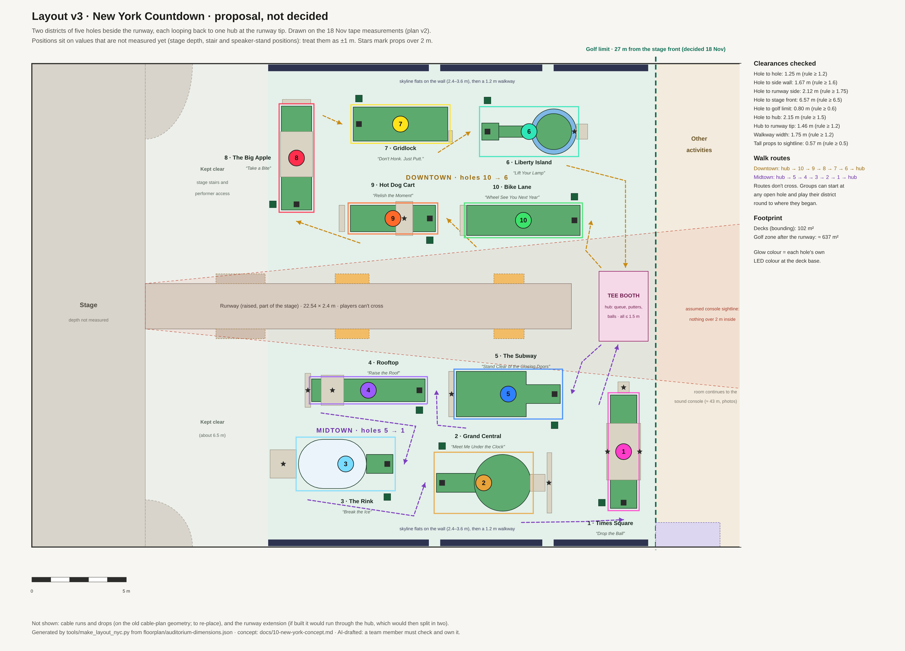

# New York Countdown: the ten holes, the glow and layout v3 (draft v1, 18 Nov)

**Status:** Claude's response to the team's New York direction (18 Nov, later). The direction is the team's; the ten holes, the layout and the lighting spec below are proposals for the team to decide by G1 (Wed 25 Nov). Measured values are marked as measured; everything else is a design target or an estimate.

See it: the 3D model (`status/countdown-golf-3d.html`, published privately at https://claude.ai/artifact/V6KWW5KgTbNyyRVLupEtxf) and the plan `floorplan/layout-v3-nyc.png`. Both come from one script, `tools/make_layout_nyc.py`, which also checks every clearance.

## What the team asked for

1. A New York vibe: New York buildings and culture, on countdown night, with a Times Square feel.
2. Holes like the hot dog and bicycle-wheel photos (`reference/user-refs/07` and `08`), with cool ideas for all ten.
3. Lighting like the Electric Greens photo (`reference/user-refs/06`): it glows, but you can still see.
4. The most interesting course to play and to look at, well thought out and robust.
5. The 3D model redone with the 18 Nov measurements.

## 1. What the three new photos teach

| Photo | What it is | Copy | Don't copy |
|---|---|---|---|
| **06 Electric Greens** (indoor, LED glow) | Low platforms with stacked, ribbed sides. A coloured LED strip at the base of every platform washes the floor, a different colour per hole. Warm wall lights and one neon script sign. The room is dim, but you can see everything | Each hole's own LED colour at the deck base (it also marks the trip edge), a strip under the rail cap, one neon-style sign per hole, a dim warm room rather than a dark one | Coloured felt on every hole (turf rolls better; use a coloured surface only where it means something, like the rink or the asphalt) |
| **07 Hot dog hole** | A plain, short rectangular deck. All the personality comes from three oversized food props (hot dog, fries, mustard bottle) and a big pun sign with a cartoon mascot behind the hole | Oversized everyday objects as the obstacles. A pun sign at the end of every hole, which is also the photo backdrop. A cheap deck with expensive-looking props | The sign's wording and the mascot: they're someone else's design |
| **08 Bicycle wheels** | A long straight lane with real bicycle wheels stood upright as a slalom, between brick borders | Free or cheap found objects, used several times on one hole. One idea, repeated | Outdoor brick borders |

**The rule they share:** a simple deck, one big idea you get from across the room, and a joke on a sign. That is cheaper than shaped decks and photographs better. Eight of the ten holes below are rectangles, or a rectangle with a round green.

## 2. The look: New York Countdown

| Layer | What it is | Why |
|---|---|---|
| Frame (the same on every hole) | Charcoal ribbed rail with a white cap (the stacked-ply look from photo 06). LED strip under the cap and at the deck base, in the hole's own colour | The repeated frame makes ten very different holes read as one place |
| Totem (the same on every hole) | A New York street-sign post: two green street blades ("THE BIG APPLE" and "HOLE 8 · PAR 3") above a round subway-style bullet in the hole's colour with its number | Instantly New York, readable from across the room, and the bullet colour matches the hole's glow |
| Signs | One pun sign per hole, styled as neon (LED neon flex on a dark board) | The joke you remember, and the photo |
| Height | Painted skyline flats on both side walls (stepped towers, a spire, rooftop water towers, lit windows), plus landmarks over 2 m: the tree, Liberty's torch, the water tower, the subway car, the Grand Central ceiling and the ball-drop tower | Above-head-height things are what people see across a crowded room |
| Ground | Street markings: zebra crossings where each district meets the hub, painted route arrows in the district colour | Joins the holes up and makes the walkways obvious |
| Colour | Ten hole colours, one per hole: 10 green, 9 ketchup orange, 8 apple red, 7 taxi yellow, 6 verdigris teal, 5 subway blue, 4 night purple, 3 ice blue, 2 brass amber, 1 Times Square magenta | Wayfinding ("meet at the purple one") and the Electric Greens effect |
| Hub | The **Tee Booth**: a red booth, a nod to the theatre-ticket booth in Times Square, with a low "NEW YORK · 11:59" sign facing the party | The start and finish of every round |

**No real logos or trademarks.** That includes the I ♥ NY logo, the transit authority's logo and line signage, bike-share brands, hot-dog brands and Broadway show titles. Use generic look-alikes, as the 3D model does. The Statue of Liberty and generic New York buildings are fine.

## 3. The story: 11:59 in New York

Ten New York places at the same minute, the last one of the year. Because everything happens at once, the story works in any order, and each 5-hole district stands on its own.

- **Find the 11:59.** Every hole hides a clock or a number reading 11:59: the bike computer on hole 10, the menu board on 9, the worm's watch on 8, a cab's meter on 7, Liberty's tablet on 6 (XI:LIX), the platform clock on 5, and so on. Put the list on the kids' scorecard. It costs almost nothing and gives families something to do while they wait.
- **Midnight (optional).** At the countdown, a volunteer lowers the glitter ball on the hole 1 tower by hand on a pulley, in time with the stage.
- **Faith link (the team's call).** Liberty's torch fits "You are the light of the world" (Matthew 5:14–16), and the 2027 tower fits "Behold, I am making all things new" (Revelation 21:5).

## 4. The ten holes

Countdown order, 10 down to 1. Downtown is holes 10 to 6, Midtown is 5 to 1. Each district has two hero holes, so the one-district format is fair to both.

| # | Hole | Sign | How it plays | The big prop | Class | Par | Deck (m) |
|---|---|---|---|---|---|---|---|
| 10 | **Bike Lane** | "Wheel See You Next Year" | Slalom between five upright bicycle wheels on a green bike lane; spokes give a different bounce every time | Five real bike wheels, a bike-rack hoop over the cup | Simple | 2 | 6.0 × 1.6 |
| 9 | **Hot Dog Cart** | "Relish the Moment" | Putt under a hot dog cart, round a giant hot dog lying as a bank wall and a heap of fries, between the mustard and ketchup | Cart with striped umbrella (2.2 m), 1 m hot dog, fries, bottles | Simple | 2 | 4.5 × 1.4 |
| 8 | **The Big Apple** | "Take a Bite" | Through the worm hole at the base of a 1.7 m apple; leaf boards funnel you in, and a miss comes back off them for another go | Glossy red apple, cartoon worm on the far side | Hero | 3 | 5.5 × 1.6 |
| 7 | **Gridlock** | "Don't Honk. Just Putt." | Pinball through a traffic jam of eight chunky yellow cabs and cones; a cab roof light flashes when you sink | Cab blocks, cones, a "Don't Honk" street sign | Mid | 3 | 5.0 × 1.8 |
| 6 | **Liberty Island** | "Lift Your Lamp" | Across a 0.6 m ferry gangway to an island green; miss and the harbour drains the ball back to the tee | Liberty's torch arm (≈ 2.6 m) and crown, a little orange ferry | Hero | 3 | 5.0 × 2.4 |
| 5 | **The Subway** | "Stand Clear of the Closing Doors" | Choose one of three tunnels: the express runs to the cup, the locals come out further away | White-tiled wall with line bullets, a subway-car front (2.4 m) | Mid | 3 | 5.5 × 2.4 |
| 4 | **Rooftop** | "Raise the Roof" | Up the fire-escape ramp to a rooftop green, cup under the water tower; too soft rolls back, too hard hits the clear back guard | Water tower (2.4 m), brownstone façade with fire escape and string lights | Mid | 3 | 6.0 × 1.2 |
| 3 | **The Rink** | "Break the Ice" | Onto a fast white rink with three skaters gliding on a slow turntable; time it or bank off the boards | A 3 m Christmas tree, borrowed from the church's Christmas decorations | Mid | 3 | 5.0 × 2.6 |
| 2 | **Grand Central** | "Meet Me Under the Clock" | A giant clock-face green; the hands, stopped at 11:59, are bumpers, and the cup sits just past 12 | Gold four-faced clock on its booth; teal ceiling backdrop with gold constellations | Hero | 3 | 5.0 × 3.0 |
| 1 | **Times Square** | "Drop the Ball" | Over the red steps, between glowing billboards, into the cup under the ball-drop tower; the cup keeps the ball and the tower lights up | 3.6 m tower with a glitter ball and lit 2027 | Hero | 2 | 6.0 × 1.4 |
| | **Total** | | | | 4 hero · 4 mid · 2 simple | **27** | ≈ 102 m² bounding |

**Ten different mechanics:** slalom (10), under-and-around (9), single gate with a funnel (8), chaos (7), bridge with drain-back (6), choice of route (5), ramp with roll-back (4), speed plus a moving obstacle (3), bumpers on a big green (2), hump and finale (1). No two holes repeat, and only one has a timing gimmick.

### How each hole is built, and why it holds up on the night

| # | Build | Robust because | Find the 11:59 |
|---|---|---|---|
| 10 | Old bike wheels (free from bike shops), cable-tied into timber cradles bolted through the deck. Vinyl bike-lane stencils on green turf | Each wheel either touches the rail or leaves at least 0.4 m (9 balls), so nothing can wedge. No power | Bike computer on the first wheel |
| 9 | Plywood cart on legs outside the rails, steel-look paint; umbrella clamped to the cart. Hot dog and fries carved from foam on plywood bases; bottles are cardboard tubes | Everything screwed down. The gap under the cart is the full lane wide and 0.2 m high, so nothing jams. Bottles touch the rails: no narrow gaps | Menu board: "Open till 11:59" |
| 8 | Thick cut-out apple: two plywood profiles 0.45 m apart, skinned, gloss red; boxed tunnel; L-frame bolted to the deck | Tunnel 0.32 m wide (7 balls) with a sloped floor and a lift-off top: no ball stops inside. A miss returns off the leaf boards | The worm's watch |
| 7 | Cabs are painted timber blocks (360 × 170 × 140 mm) screwed from below; charcoal needle-punch "asphalt" with painted lines | Every gap is closed or at least 0.25 m, and inside corners are filled. The roof light is a bonus on a battery | A cab's meter |
| 6 | Harbour is a channel 40 mm below the deck that slopes back to the tee. Torch arm is box-section plywood on a weighted pedestal behind the island | No lost balls and no marshal resets. The arm stands outside the play area on its own base; the flame is a battery LED | Liberty's tablet: XI:LIX |
| 5 | Tile wall (printed vinyl on plywood) with three boxed tunnels; car front is a painted flat | Tunnels have lift-off lids and sloped exits. Wall and car front bolt to the deck frame | Platform clock |
| 4 | 1:6 ramp to a raised green (+200 mm); water tower on its own four-leg base outside the rails; façade is a painted flat | Clear guards on both sides and the back. The barrel's underside is 1.4 m up, out of a putter's swing | Rooftop party clock |
| 3 | White rink (white felt or laminate, chosen at the prototype test), rink boards, a flush 0.9 m turntable on a battery gear motor | The only moving part on the course, and optional: if it stops, the skaters become fixed bumpers. Test the surface speed on the prototype | Rink clock |
| 2 | Clock face printed or inlaid in the turf; hands are 50 mm solid timber with rounded ends; clock and backdrop on their own bases | Hands screwed down; clock prop outside the rails | The whole hole |
| 1 | Hump painted as the red steps; billboard flats either side on their own feet; tower is a truss on a weighted base, guyed; ball-return cup with a battery microswitch | If the light and cheer fail, the hole still plays and still collects the balls | Billboard clock |

### Rules that apply to every hole

- **A miss never needs a marshal.** Every hole has a fallback: the ball rolls back, drains back or bounces back. The 5-stroke cap stays.
- **No ball stops where a putter can't reach it.** Gaps are closed or at least 0.25 m; tunnels have sloped floors and lift-off lids; inside corners are filled.
- **Nothing loose.** Props are screwed down or stand on weighted bases outside the rails. Tall props are braced or guyed, and nothing hangs over a walkway.
- **Effects are a bonus.** The course plays with all effect power off. Only one moving part (the rink turntable), and it plays when stopped.
- **Power.** 12/24 V only on the course. Batteries for effects; LED supplies off the course on an RCD-protected circuit, never ND18 or ND21.
- **Time.** Aim for 2 to 2.5 minutes per group per hole, and time every hole at the dry run. The hero holes must not be slower than the rest (see `09-city-concept.md` section 4).
- **Kids.** A junior tee mat on every hole.
- **Spares kit.** Balls, putters, a spare LED controller and supply, cable ties, gaffer tape, a spare bike wheel, touch-up paint.

## 5. Lighting: it glows, but you can see

| Item | Spec (proposal) |
|---|---|
| Deck base | LED strip in a recessed kick at the base of every deck, in the hole's colour, washing about 0.5–1 m of floor. This is also the trip-edge marker |
| Rail | A second strip under the rail cap, lighting the playing edge so the ball stays visible |
| Room | A dim warm wash from the rig over each district: enough to see the floor, the ball and each other. Not a blackout. The 3D page's "Room fully dark" setting shows why |
| Signs | LED neon flex on each pun sign and the hub sign; skyline windows backlit or painted |
| Colour behaviour | Fixed colours, not colour-cycling, so the colours work as wayfinding. A slow pulse on Times Square only |
| Quantity (estimate) | About 150 m of strip per layer, so about 300 m for two layers; the budget model allows 150 m. At the budget-strip prices in `08-budget-model.md` (S$3–6 per m), the second layer adds roughly S$0.5–0.9k plus power supplies |

**What it depends on:** production agreeing to a dim warm wash over both districts while golf runs. That is now the main lighting question for production.

## 6. Layout v3 inside the golf zone

- **Two districts beside the runway**, each a loop that starts and ends at the **Tee Booth** in the 4.46 m strip past the runway tip. Downtown is on the top side (holes 10 → 6), Midtown on the bottom side (5 → 1). The walk routes don't cross.
- **Kept clear:** about 6.5 m in front of the stage for the stairs and performers. The stage front isn't measured, so this moves with it.
- **Hole 1, the finale, runs along the golf limit** into the corner by the hub, so its 3.6 m ball-drop tower faces the party floor.

**Clearances** (checked by `tools/make_layout_nyc.py`; the script fails if any rule breaks):

| Rule | Tightest value | Rule |
|---|---|---|
| Hole to hole | 1.25 m (5 and 4) | ≥ 1.2 m |
| Hole to side wall | 1.67 m | ≥ 1.6 m (0.4 m flats, then a 1.2 m walkway) |
| Hole to runway side | 2.12 m | ≥ 1.75 m (0.515 m speaker stands, then a 1.2 m walkway) |
| Hole to stage front | 6.57 m | ≥ 6.5 m |
| Hole to golf limit | 0.80 m | ≥ 0.6 m |
| Hole to hub | 2.00 m | ≥ 1.5 m |
| Hub to runway tip | 1.46 m | ≥ 1.2 m (the only walkway between the districts) |
| Narrowest walkway on a route | 1.75 m | ≥ 1.2 m |
| Props over 2 m to the console sightline | 1.08 m | ≥ 0.5 m (sightline assumed) |

**What could break it** (confirm before anyone fixes a position):
- **Stage depth.** Every x position moves with the stage front, which isn't measured.
- **Stairs and speaker stands.** Their positions along the runway aren't measured. The 1.75 m runway clearance covers their depth, but performers may need more room at the stairs.
- **Side-wall exits.** If there are exits in the side walls, the skyline flats must leave them clear. The photos (19 Nov) show two in the 11.65 m wall; the 3D model leaves gaps at their guessed positions, and the totems of holes 7 and 6 may need to move (`docs/13-auditorium-from-photos.md`).
- **The runway extension.** If the ≈ 8.6 m extension is built, it runs through the hub. The hub would split into one booth per district.
- **Floor cables.** Not re-placed on the v2 geometry yet. Re-place them before fixing positions.
- **Where the countdown crowd stands.** Golf now fills both sides of the runway. If the crowd needs that floor at midnight, golf closes and is cleared before the countdown, or the team moves the golf limit.
- **Ceiling and rig.** The tallest props are 3–3.6 m. Check the clearance under the rig.

## 7. What it changes from Bright City (estimate)

The method stays the same: one repeated frame, layered heights, clustered districts and a hub. What changes:

| Change | Direction | Why |
|---|---|---|
| Second LED layer at the deck base | Adds about S$0.5–0.9k plus supplies | The Electric Greens look |
| Ten neon-style pun signs | Adds | One per hole |
| Mostly rectangular decks | Saves | Less cutting and fewer curved rails |
| Found and borrowed objects (bike wheels, the Christmas tree) and foam food props | Saves | Cheap, and they carry the look |
| Hero props (apple, torch, Grand Central clock and backdrop, ball-drop tower) | About the same | Same count as the four hero props in the budget model |
| **Net** | **Roughly neutral to +S$1–2k** | Estimate, not quotes |

## 8. To decide by G1 (Wed 25 Nov)

1. **New York Countdown as the art direction?** It replaces the Bright City recommendation and follows the team's 18 Nov direction.
2. **The ten holes:** keep them, or swap some from the bench below.
3. **Layout v3:** both sides of the runway with the hub at the tip.
4. **Lighting:** LED glow on every deck, plus a dim warm wash from production.
5. **Questions for production:** can you give a dim warm wash over both districts while golf runs? Where does the countdown crowd stand? What does the sound console need to see? Is the runway extension being built? Which floor cables stay? What clearance is there under the rig for 3–3.6 m props?

## 9. The bench: more ideas to swap in

| Idea | Sign | How it plays | Good swap for |
|---|---|---|---|
| **Dollar Slice** | "Fuhgeddaboudit" | A pizza-slice green that narrows to the cup, with pepperoni bumpers and a stack of pizza boxes | 9 or 7 |
| **Bodega Cat** | "Open 24/7" | Pyramids of giant cans (painted cardboard tubes) to knock round, with a cat watching from the counter | 7 |
| **Coney Island** | "Wonder Wheel" | The spec v1 windmill rebuilt as a turning Ferris wheel: a timing hole | 3 (only one timing hole on the course) |
| **Broadway** | "The Show Must Go On" | Through red curtain strips onto a stage green under marquee bulbs | 4 or 5 |
| **Brooklyn Bridge** | "Over the River" | A narrow suspension bridge with cable strings over the East River | 6 |
| **Everything Bagel** | "Hole in One" | A giant bagel standing on edge: the ball goes through the hole | 8 |
| **Library Lions** | "Patience & Fortitude" | Up the steps between the two library lions, with giant books as bank walls | 4 |
| **Manhole Steam** | "Mind the Steam" | Three manhole covers, but only one is the cup; ribbon "steam" | 10 |
